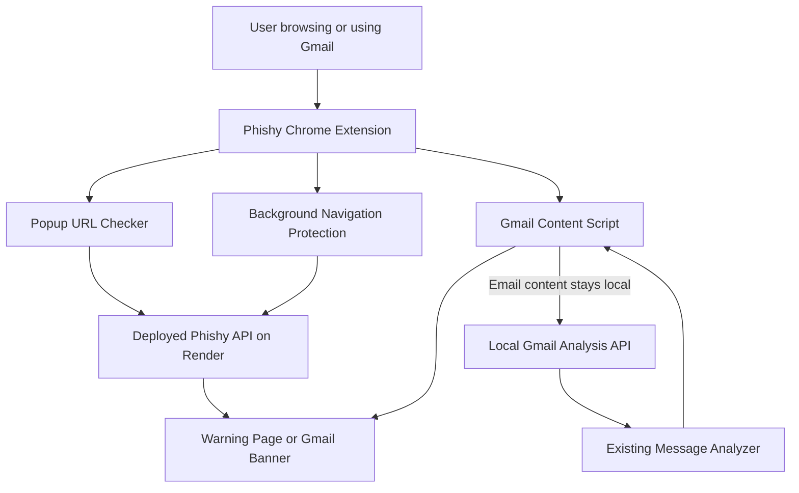

# 🛡️ Phishy — Intelligent Phishing Detection & Defense

<p align="center">
  <strong>A browser-based defense layer for suspicious URLs, websites, and Gmail messages.</strong>
</p>

<p align="center">
  <a href="https://phishing-defense-h161.onrender.com/">
    
  </a>
  
  
  
  
</p>

---

## 📌 Overview

**Phishy** is a phishing detection and defense application designed to help users identify potentially dangerous web destinations and deceptive email messages. It combines a Chrome browser extension, a Python-based analysis backend, and a local Gmail analysis service to provide security checks during everyday browsing and email use.

Phishing attacks frequently rely on fake login pages, misleading links, brand impersonation, and social engineering. Phishy adds an additional layer of protection by analyzing URLs and email content and presenting findings to the user.

The project follows a **two-path analysis architecture**:

- **URL and website protection:** the Chrome extension sends URLs to the deployed Phishy analysis API for assessment.
- **Gmail message protection:** the extension sends relevant email content to a local Python service for analysis on the user's machine.

This separation allows email content to remain local while retaining the deployed URL-analysis functionality.

> **Project goal:** Make phishing warnings more accessible by integrating security analysis into the browser and Gmail workflow.

## ✨ Key Features

### 🌐 URL and Website Protection
- Analyze a URL through the Phishy browser popup.
- Check eligible top-level website navigations using the extension's background service worker.
- Use the deployed API to obtain URL-analysis results.
- Display the existing warning page when the analysis indicates a block-worthy threat.
- Apply cooldown logic to reduce repeated checks of the same URL.

### 📩 Incoming Gmail Analysis
- Detect an opened Gmail message.
- Extract available sender information, subject, message text, and HTTP(S) links.
- Submit the extracted message data to the local analyzer.
- Display an analysis banner with the returned verdict and risk score when available.
- Provide a warning when the analyzer identifies a potentially suspicious message.

### ✉️ Outgoing Email Protection
- Check a Gmail draft before the Send action proceeds.
- Display a confirmation prompt when the local analysis classifies a draft as suspicious.
- Let the user cancel sending or explicitly choose to continue.
- Report when the local analyzer is unavailable instead of silently presenting the draft as successfully scanned.

### 🔒 Privacy-Aware Email Analysis
- Process Gmail content through a local service at `127.0.0.1:8765`.
- Keep email content separate from the deployed Render URL-analysis request.
- Restrict the local API to the configured Chrome extension origin.
- Validate email payload fields and apply input-length limits.

### 🧩 Modular Architecture
- Keep the browser extension, local analysis endpoint, and deployed URL API as separate components.
- Reuse the project's existing message-analysis pipeline.
- Maintain the existing URL-checking behavior while adding Gmail protection.

## 🏗️ System Architecture



### Analysis flow

| Component | Responsibility |
|---|---|
| Chrome popup | Initiates a URL check for the active tab. |
| Background service worker | Checks eligible top-level navigations and handles URL warnings. |
| Gmail content script | Extracts incoming message information and checks outgoing drafts. |
| Deployed API | Performs the configured URL analysis. |
| Local Gmail API | Receives Gmail message data from the extension and calls the existing message analyzer. |
| Message analyzer | Returns the available verdict, risk score, evidence, and guidance. |
| Warning interface | Presents results so the user can make an informed decision. |

## 🧰 Technology Stack

- **Python** — backend and analysis orchestration.
- **FastAPI** — local Gmail analysis endpoint and application API components.
- **Uvicorn** — local ASGI server.
- **JavaScript** — Chrome extension logic and Gmail page integration.
- **Chrome Extensions Manifest V3** — extension permissions, popup, background service worker, and content scripts.
- **HTML and CSS** — popup, warning interface, and application presentation.
- **Machine-learning and rule-based components** — according to the models and analysis logic configured in the project.
- **Render** — deployment of the public URL-analysis service.

The exact detection methods and models depend on the components enabled in the repository; no accuracy or benchmark result is claimed here.

## 📁 Project Structure

```text
phishing-defense/
├── app/
│   ├── main.py                 # Main application and analysis entry point
│   ├── config.py               # Application configuration
│   ├── ratelimit.py            # Rate-limiting logic
│   ├── store.py                # Storage-related functionality
│   └── static/                 # Static web interface assets
├── data/                       # Project data and datasets
├── engine/                     # Analysis-engine components
├── experiments/                # Experiments and evaluation work
├── extension/
│   ├── manifest.json           # Chrome extension configuration
│   ├── background.js           # URL navigation protection
│   ├── gmail_content.js        # Incoming and outgoing Gmail checks
│   ├── popup.html              # Extension popup
│   ├── popup.js                # Popup URL-analysis behavior
│   ├── warning.html            # Warning interface
│   └── icons/                  # Extension icons
├── feeds/                      # Threat-feed related components
├── ml/                         # Machine-learning code
├── models/                     # Model assets, if included
├── scripts/
│   ├── local_gmail_api.py      # Local Gmail analysis service
│   └── gmail_analyze.py        # Gmail analysis utility
├── tests/                      # Automated tests
├── Dockerfile                  # Container configuration
├── requirements.txt            # Python dependencies
├── start.sh                    # Application startup script
└── README.md                   # Project documentation
```

> The tree highlights the principal project components. Some directories may contain additional files, and the exact contents depend on the current checkout.

## ⚙️ Requirements

Before running Phishy locally, ensure that you have:

- Python installed at a version supported by the project dependencies.
- Git installed.
- Google Chrome.
- Access to the project repository and its required model assets.
- Internet connectivity for the deployed URL-analysis service.
- A Gmail account for testing the extension.

The local Gmail analyzer and Chrome extension must be running together for Gmail scanning to work.

## 🚀 Installation and Setup

### 1. Clone the repository

```bash
git clone https://github.com/Nishuaj17/phishing-defense.git
cd phishing-defense
```

If you already have the project locally, navigate to your existing project directory instead.

### 2. Create and activate a virtual environment

On macOS or Linux:

```bash
python3 -m venv .venv
source .venv/bin/activate
```

### 3. Install dependencies

```bash
python -m pip install --upgrade pip
pip install -r requirements.txt
```

If a particular model or optional component has additional installation requirements, follow the instructions associated with that component.

### 4. Start the main application

Use the repository's startup script:

```bash
bash start.sh
```

The script's configuration determines which application components and ports it starts. Review `start.sh` if you need to confirm the startup behavior.

### 5. Start the local Gmail analysis service

Open a **separate terminal** from the project root:

```bash
source .venv/bin/activate
PHISHY_EXTENSION_ID=kjpdafcdcnneekokjnhkdofjckdmjpmb \
python scripts/local_gmail_api.py
```

The extension ID shown above is the current development ID used in this setup. If Chrome assigns a different ID to your unpacked extension, update the environment variable and the local API configuration accordingly.

The local analyzer listens on:

```text
http://127.0.0.1:8765
```

### 6. Verify the local analyzer

In another terminal, run:

```bash
curl http://127.0.0.1:8765/health
```

Expected response:

```json
{
  "status": "ok",
  "analyzer": "local"
}
```

This verifies that the health endpoint is reachable. A successful health check alone does not establish that every model or detection component is functioning correctly.

## 🧩 Load the Chrome Extension

1. Open Google Chrome.
2. Navigate to `chrome://extensions`.
3. Enable **Developer mode**.
4. Select **Load unpacked**.
5. Choose the repository's `extension/` directory.
6. Confirm that Phishy is enabled.
7. Open Gmail at `https://mail.google.com/` and refresh the page.

If the extension is already loaded, click **Reload** after changing its source files and refresh Gmail afterward.

### Required extension configuration

The Manifest V3 configuration should include the permissions and host access required by the current implementation:

- `activeTab`
- `storage`
- `tabs`
- `webNavigation`
- The deployed URL API host
- The local API host at `http://127.0.0.1:8765/*`
- Gmail content-script matching for `https://mail.google.com/*`

Only grant permissions needed by the implementation. If the extension ID changes, update the local API's allowed origin as well.

## 🧪 Using Phishy

### Check a URL

1. Open Chrome.
2. Navigate to the page you want to assess, or use the Phishy popup.
3. Review the result returned by the deployed API.
4. If the extension redirects to its warning page, review the available information before deciding what to do.

Phishy should be treated as a risk-assessment layer rather than a guarantee that every allowed page is safe.

### Analyze an incoming Gmail message

1. Ensure the local Gmail analyzer is running.
2. Open Gmail and refresh the page.
3. Open a message.
4. Wait for the analysis banner.
5. Review the verdict, risk score, and warning text when available.

The extension extracts the email fields supported by its current Gmail integration and sends them to the local service for analysis.

### Check an outgoing Gmail draft

1. Ensure the local Gmail analyzer is running.
2. Compose a harmless test email.
3. Click **Send**.
4. Wait for the local analysis result.
5. If a warning appears, cancel sending or explicitly choose to continue.

Use a test account and harmless messages when validating this behavior. A warning or safe verdict depends on the configured analysis logic and should not be interpreted as an infallible decision.

## 🔐 Privacy and Security

Phishy separates its two main analysis paths.

### Gmail content

The Gmail extension sends the extracted sender, subject, message text, and available links to:

```text
http://127.0.0.1:8765/analyze
```

The local service calls the existing message analyzer. Gmail content is **not intentionally sent to the Render URL-analysis endpoint** by this integration.

The local service checks the request's extension origin and validates the payload. It binds to the loopback interface rather than listening on all network interfaces.

### Website URLs

The extension's existing URL-protection flow uses the deployed service:

```text
https://phishing-defense-h161.onrender.com/
```

The visited URL is sent for URL analysis. Users should understand this distinction when evaluating the privacy characteristics of the application.

### Security recommendations

- Never commit API keys, private tokens, passwords, or sensitive `credentials.json` files.
- Keep secrets in environment variables or other appropriate local configuration.
- Do not expose the local Gmail API publicly without a proper authentication and security design.
- Keep dependencies updated and review extension permissions.
- Test with synthetic or authorized data.
- Treat extracted email text, links, and model output as untrusted input.
- Do not use Phishy as the sole security control for sensitive accounts or transactions.

## 🧪 Testing and Validation

Run the tests available in the repository using the project's configured test runner. For a pytest-based suite:

```bash
source .venv/bin/activate
pytest -q
```

Before a demonstration or release, validate these scenarios:

| Test | Expected behavior |
|---|---|
| Local API health check | Returns the local service status. |
| Ordinary incoming email | Produces an analysis result when the service and message extraction are working. |
| Suspicious incoming email | Displays a warning when the analyzer returns a suspicious verdict or action. |
| Outgoing draft | Triggers analysis before sending proceeds. |
| Suspicious outgoing draft | Offers the configured cancel/continue decision. |
| Local analyzer unavailable | Reports that analysis could not be completed. |
| URL navigation | Uses the existing deployed URL-analysis flow. |
| Extension reload | Loads the current manifest and source files without extension errors. |

Record actual test results before making claims about accuracy, recall, precision, false-positive rate, or performance. Do not present unmeasured values as benchmark results.

## 🛠️ Troubleshooting

### Gmail analysis does not appear

- Confirm the local service is running.
- Check `http://127.0.0.1:8765/health`.
- Reload Phishy from `chrome://extensions`.
- Refresh Gmail.
- Inspect the Gmail page Console and the extension's service-worker Console.

### Local API returns an error

- Confirm that the virtual environment is active.
- Review the local API terminal output.
- Verify that the extension ID matches the configured allowed origin.
- Confirm that port `8765` is available.

### URL protection does not respond

- Check your internet connection and the deployed API status.
- Inspect the extension service-worker Console.
- Verify that the Render host permission is present.
- Review the API response and rate-limit behavior.

### Chrome reports an extension error

- Open `chrome://extensions`.
- Click **Errors**, if available.
- Review the Service Worker inspection Console.
- Correct the reported source or manifest issue, reload the extension, and refresh Gmail.

### A message is classified unexpectedly

Detection is not infallible. Review the available evidence and test with multiple authorized examples. Do not assume that a safe verdict guarantees that a message is legitimate.

## 🔭 Future Improvements

Potential next steps include:

- More extensive testing on labeled phishing and legitimate email datasets.
- Evaluation using precision, recall, F1-score, false-positive rate, and latency.
- Improved robustness to Gmail interface changes.
- Better explainability for individual detection signals.
- More comprehensive testing of outgoing-message interception and failure cases.
- Additional threat-intelligence integrations where appropriate.
- Automated regression tests for URL and email analysis.
- More detailed privacy documentation and deployment hardening.

These are possible enhancements, not claims that every item is already implemented.

## ⚠️ Limitations and Disclaimer

Phishy is a defensive project intended to assist with phishing awareness and risk assessment. Detection results can be wrong, and browser interfaces, APIs, and threat patterns can change.

The extension's outgoing-email interception depends on Gmail's current interface and should be tested after significant Gmail or extension changes. A local health check does not prove that all analysis features are working, and an email that passes analysis may still be malicious.

Use the project only for lawful, authorized security testing. Do not send real phishing emails or expose sensitive user data as part of a demonstration.

## 👩‍💻 Project

**Phishy — Intelligent Phishing Detection & Defense**

Repository: [Nishuaj17/phishing-defense](https://github.com/Nishuaj17/phishing-defense)

Deployed service: [phishing-defense-h161.onrender.com](https://phishing-defense-h161.onrender.com/)

---

<p align="center">
  <strong>🛡️ Browse carefully. Verify before you trust.</strong>
</p>